# Diagramas de actividad — AutoCar

Bernal Justino · Marino Lautaro · Kasparian Federico · Programación en Ambiente Web · UNLu Mercedes · 2026

Un diagrama general con todas las funcionalidades y un diagrama por flujo. Los flujos con varios actores usan **carriles** (swimlanes): quién hace cada acción.

**Notación** (Mermaid no tiene diagrama de actividad nativo, así que se usa `flowchart` con la notación de UML):

| Figura | Elemento UML |
|---|---|
| Círculo negro | Nodo inicial |
| Círculo con borde doble | Nodo final |
| Rectángulo redondeado | Acción |
| Rombo | Decisión / fusión |
| Barra negra | Fork / join (acciones en paralelo) |
| Recuadro con título | Carril (actor) |

**Estado de cada flujo:** ✅ implementado (front + API) · 🟡 parcial · 📐 maqueta (pantalla sin API todavía, según [front/README.md](../front/README.md)).

| # | Flujo | Estado |
|---|---|---|
| 0 | [Visión general](#0-visión-general-de-la-aplicación) | — |
| 1 | [Registro, inicio y cierre de sesión](#1-registro-inicio-y-cierre-de-sesión) | ✅ |
| 2 | [Explorar catálogo y ver detalle](#2-explorar-catálogo-y-ver-detalle) | ✅ |
| 3 | [Publicar un vehículo](#3-publicar-un-vehículo) | 🟡 API lista, pantalla maqueta |
| 4 | [Gestionar mis publicaciones](#4-gestionar-mis-publicaciones) | 🟡 API lista, pantalla maqueta |
| 5 | [Moderación y ABM del administrador](#5-moderación-y-abm-del-administrador) | ✅ |
| 6 | [Favoritos y listas](#6-favoritos-y-listas) | 📐 |
| 7 | [Propuesta de canje](#7-propuesta-de-canje) | 📐 |
| 8 | [Mensajería](#8-mensajería-entre-usuarios) | 📐 |
| 9 | [Meta-búsqueda con IA](#9-meta-búsqueda-con-ia) | 📐 |
| 10 | [Tasación con IA](#10-tasación-con-ia) | 📐 |
| 11 | [Planes y suscripción](#11-planes-y-suscripción-simulada) | 📐 |
| 12 | [Adhesión de un taller](#12-adhesión-de-un-taller) | 📐 |
| 13 | [Verificación del vehículo en un taller](#13-verificación-del-vehículo-en-un-taller) | 📐 |
| 14 | [Reportes y moderación de denuncias](#14-reportes-y-moderación-de-denuncias) | 📐 |
| 15 | [Mapa de vehículos](#15-mapa-de-vehículos) | 📐 |

---

## 0. Visión general de la aplicación

```mermaid
flowchart TD
    inicio((" ")):::inicio --> landing("Abrir AutoCar (landing)")
    landing --> q_sesion{"¿Tiene sesión?"}
    q_sesion -- "no" --> visitante("Navegar como visitante")
    visitante --> q_accion_v{"¿Qué hace?"}
    q_accion_v -- "explorar" --> F2["Flujo 2: Explorar catálogo"]
    q_accion_v -- "info / ayuda" --> info("Ver guía, planes, contacto, legales")
    q_accion_v -- "adherir taller" --> F12["Flujo 12: Adhesión de taller"]
    q_accion_v -- "acción que pide cuenta" --> F1["Flujo 1: Registro / login"]
    F1 --> q_rol
    q_sesion -- "sí" --> q_rol{"¿Rol del usuario?"}

    q_rol -- "usuario" --> menu("Menú del usuario")
    q_rol -- "mecánico" --> F13m["Flujo 13: Panel del taller"]
    q_rol -- "admin" --> F5["Flujo 5: Panel de administración"]

    menu --> fork1[" "]:::barra
    fork1 --> F2b["Flujo 2: Buscar y ver detalle"]
    fork1 --> F3["Flujo 3/4: Publicar y gestionar publicaciones"]
    fork1 --> F6["Flujo 6: Favoritos"]
    fork1 --> F7["Flujo 7: Canje"]
    fork1 --> F8["Flujo 8: Mensajes"]
    fork1 --> F9["Flujo 9/10: Meta-búsqueda y tasación"]
    fork1 --> F11["Flujo 11: Plan"]
    fork1 --> F13["Flujo 13: Verificar en taller"]
    fork1 --> F14["Flujo 14: Reportar"]
    fork1 --> F15["Flujo 15: Mapa"]

    F2 --> fin
    info --> fin
    F12 --> fin
    F2b & F3 & F6 & F7 & F8 & F9 & F11 & F13 & F14 & F15 --> join1[" "]:::barra
    join1 --> salir("Cerrar sesión")
    F13m --> salir
    F5 --> salir
    salir --> fin(((" "))):::fin

    classDef inicio fill:#111,stroke:#111
    classDef fin fill:#111,stroke:#111
    classDef barra fill:#111,stroke:#111,color:#111
```

---

## 1. Registro, inicio y cierre de sesión

`registro.html` → `POST /api/registro` + `POST /api/login` · `login.html` → `POST /api/login` · `cuenta.html` → `GET /api/me`, `POST /api/logout`

```mermaid
flowchart TD
    subgraph U["Usuario"]
        inicio((" ")):::inicio --> q_cuenta{"¿Tiene cuenta?"}
        q_cuenta -- "no" --> form_reg("Completar nombre, email, contraseña y confirmación")
        q_cuenta -- "sí" --> form_login("Ingresar email y contraseña")
        corregir_reg("Corregir datos marcados")
        corregir_login("Reintentar")
        usar("Usar la app con sesión")
        pedir_salir("Pulsar Salir en Mi cuenta")
    end

    subgraph F["Front (navegador)"]
        val_reg{"¿Validación del cliente OK?"}
        val_login{"¿Campos completos?"}
        guardar("Guardar usuario y token CSRF en sessionStorage")
        volver("Redirigir a ?volver= o a home")
        borrar("Borrar sessionStorage y volver a home")
    end

    subgraph A["API (AuthController)"]
        val_srv{"¿Nombre 2-80, email válido, contraseña 8-72 con letra y número, confirmación igual?"}
        q_dup{"¿Email ya registrado?"}
        crear("Usuario::crear con hash bcrypt → 201")
        buscar("Buscar usuario por email")
        q_pass{"¿password_verify OK?"}
        err401("401: email o contraseña incorrectos")
        sesion("Auth::iniciarSesion: JWT en cookie HttpOnly + devolver csrf")
        logout("Auth::cerrarSesion: borrar cookie → 204")
    end

    form_reg --> val_reg
    val_reg -- "no" --> corregir_reg --> form_reg
    val_reg -- "sí" --> val_srv
    val_srv -- "no (422)" --> corregir_reg
    val_srv -- "sí" --> q_dup
    q_dup -- "sí (422)" --> corregir_reg
    q_dup -- "no" --> crear --> buscar

    form_login --> val_login
    val_login -- "no" --> corregir_login --> form_login
    val_login -- "sí" --> buscar
    buscar --> q_pass
    q_pass -- "no" --> err401 --> corregir_login
    q_pass -- "sí" --> sesion --> guardar --> volver --> usar
    usar --> pedir_salir --> logout --> borrar --> fin(((" "))):::fin

    classDef inicio fill:#111,stroke:#111
    classDef fin fill:#111,stroke:#111
```

Si el email no existe el servidor igual calcula un hash, para tardar lo mismo y no revelar qué emails tienen cuenta.

---

## 2. Explorar catálogo y ver detalle

`home.html` / `buscar.html` → `GET /api/vehiculos`, `GET /api/marcas` · `vehiculo.html?id=N` → `GET /api/vehiculos/{id}`

```mermaid
flowchart TD
    inicio((" ")):::inicio --> abrir("Abrir home o búsqueda")
    abrir --> fork1[" "]:::barra
    fork1 --> marcas("Cargar marcas (GET /api/marcas)")
    fork1 --> listado("Cargar página 1 (GET /api/vehiculos)")
    marcas & listado --> join1[" "]:::barra
    join1 --> ver("Ver grilla de 9 vehículos disponibles")
    ver --> q_accion{"¿Qué hace?"}
    q_accion -- "filtra" --> filtrar("Elegir marca, precio, combustible o texto")
    filtrar --> listado2("Pedir resultados con los filtros")
    listado2 --> q_vacio{"¿Hay resultados?"}
    q_vacio -- "no" --> vacio("Mostrar estado vacío y sugerir limpiar filtros") --> q_accion
    q_vacio -- "sí" --> ver
    q_accion -- "cambia de página" --> pagina("Pedir página N") --> ver
    q_accion -- "abre un vehículo" --> detalle("GET /api/vehiculos/{id}")
    detalle --> q_existe{"¿Existe y está visible?"}
    q_existe -- "no (404)" --> nf("Mostrar 'publicación no encontrada'") --> q_accion
    q_existe -- "sí" --> ficha("Ver galería, ficha técnica, precio y canje")
    ficha --> q_det{"¿Siguiente acción?"}
    q_det -- "volver" --> ver
    q_det -- "guardar" --> f6["Flujo 6: Favoritos"]
    q_det -- "consultar" --> f8["Flujo 8: Mensajes"]
    q_det -- "proponer canje" --> f7["Flujo 7: Canje"]
    q_det -- "reportar" --> f14["Flujo 14: Reporte"]
    q_det -- "ninguna" --> fin(((" "))):::fin
    f6 & f8 & f7 & f14 --> q_login{"¿Tiene sesión?"}
    q_login -- "no" --> login("Ir a login con ?volver=vehiculo") --> fin
    q_login -- "sí" --> fin

    classDef inicio fill:#111,stroke:#111
    classDef fin fill:#111,stroke:#111
    classDef barra fill:#111,stroke:#111,color:#111
```

---

## 3. Publicar un vehículo

`publicar.html` (6 pasos) → `POST /api/mis-vehiculos` (multipart: campos + `fotos[]`)

```mermaid
flowchart TD
    subgraph U["Publicador"]
        inicio((" ")):::inicio --> abrir("Abrir 'Publicar'")
        p1("Paso 1: marca, modelo, versión, año")
        p2("Paso 2: kilometraje, combustible, transmisión, condición")
        p3("Paso 3: subir fotos (máx. 5, JPG/PNG/WebP, 2 MB c/u)")
        p4("Paso 4: precio, acepta canje y qué busca")
        p5("Paso 5: localidad")
        p6("Paso 6: revisar y confirmar")
        corregir("Corregir los campos marcados")
        ver_pend("Ver la publicación 'pendiente de revisión'")
    end

    subgraph F["Front"]
        q_ses{"¿Sesión iniciada?"}
        a_login("Redirigir a login")
        q_cupo{"¿El plan tiene cupo?"}
        a_plan("Ofrecer cambiar de plan (Flujo 11)")
        val_paso{"¿Paso válido?"}
        enviar("Enviar FormData con X-CSRF-Token")
    end

    subgraph A["API (PublicacionController)"]
        guard{"¿Cookie y CSRF válidos?"}
        validar{"¿Vehiculo::validar y Foto::validarSubidas OK?"}
        trans("Transacción: crear vehículo (estado = pendiente) y guardar fotos")
        q_tx{"¿Commit OK?"}
        rollback("Rollback y error 500")
        ok("201 con el vehículo y sus fotos")
    end

    abrir --> q_ses
    q_ses -- "no" --> a_login --> fin1(((" "))):::fin
    q_ses -- "sí" --> q_cupo
    q_cupo -- "no" --> a_plan --> fin1
    q_cupo -- "sí" --> p1 --> p2 --> p3 --> p4 --> p5 --> p6 --> val_paso
    val_paso -- "no" --> corregir --> p1
    val_paso -- "sí" --> enviar --> guard
    guard -- "no (401/403)" --> a_login
    guard -- "sí" --> validar
    validar -- "no (422)" --> corregir
    validar -- "sí" --> trans --> q_tx
    q_tx -- "no" --> rollback --> fin1
    q_tx -- "sí" --> ok --> ver_pend --> f5["Queda en la cola del admin (Flujo 5)"] --> fin2(((" "))):::fin

    classDef inicio fill:#111,stroke:#111
    classDef fin fill:#111,stroke:#111
```

La validación de cada paso en el cliente es una comodidad; el servidor vuelve a validar todo y fija el estado `pendiente` (el usuario no lo puede elegir). El control de cupo por plan está en el diseño pero el back todavía no lo aplica.

---

## 4. Gestionar mis publicaciones

`mis-publicaciones.html` → `GET`, `PUT`, `PATCH …/estado`, `DELETE /api/mis-vehiculos[/{id}]`

```mermaid
flowchart TD
    inicio((" ")):::inicio --> listar("GET /api/mis-vehiculos")
    listar --> ver("Ver publicaciones agrupadas por estado")
    ver --> elegir("Elegir una publicación")
    elegir --> q_prop{"¿Es del usuario y no está eliminada?"}
    q_prop -- "no" --> e404("404: la publicación no existe") --> ver
    q_prop -- "sí" --> q_estado{"¿Estado?"}

    q_estado -- "rechazado" --> motivo("Leer motivo del rechazo") --> q_acc
    q_estado -- "pendiente / disponible / vendido" --> q_acc{"¿Qué hace?"}

    q_acc -- "editar" --> q_vend{"¿Está vendida?"}
    q_vend -- "sí" --> e409("409: un vehículo vendido no se edita") --> ver
    q_vend -- "no" --> editar("Modificar campos y enviar PUT")
    editar --> q_val{"¿Validación OK?"}
    q_val -- "no (422)" --> editar
    q_val -- "sí" --> pend("Vuelve a 'pendiente' para revisión del admin") --> ver

    q_acc -- "marcar vendido" --> q_disp{"¿Está disponible?"}
    q_disp -- "no (422)" --> ver
    q_disp -- "sí" --> vendido("PATCH estado = vendido") --> ver

    q_acc -- "eliminar" --> confirmar{"¿Confirma?"}
    confirmar -- "no" --> ver
    confirmar -- "sí" --> baja("DELETE: baja lógica, estado = eliminado") --> ver

    q_acc -- "verificar" --> f13["Flujo 13: Verificación"]
    q_acc -- "tasar" --> f10["Flujo 10: Tasación"]
    q_acc -- "ver propuestas" --> f7["Flujo 7: Canje"]
    q_acc -- "salir" --> fin(((" "))):::fin
    f13 & f10 & f7 --> fin

    classDef inicio fill:#111,stroke:#111
    classDef fin fill:#111,stroke:#111
```

La baja es lógica para no romper las conversaciones y propuestas que referencian el vehículo.

---

## 5. Moderación y ABM del administrador

`admin.html`, `admin-vehiculos.html`, `admin-vehiculo.html` → `/api/admin/vehiculos…` (guard `admin`: el rol se consulta en la base en cada pedido)

```mermaid
flowchart TD
    inicio((" ")):::inicio --> entrar("Abrir panel de administración")
    entrar --> q_admin{"¿Sesión con rol admin?"}
    q_admin -- "no" --> fuera("401/403 y volver a home") --> fin(((" "))):::fin
    q_admin -- "sí" --> q_tarea{"¿Qué tarea?"}

    q_tarea -- "moderar" --> cola("GET ?estado=pendiente: cola de moderación")
    cola --> revisar("Abrir detalle con fotos (GET /admin/vehiculos/{id})")
    revisar --> q_dec{"¿Decisión?"}
    q_dec -- "aprobar" --> aprobar("PATCH estado = disponible") --> publicada("Aparece en el catálogo")
    q_dec -- "rechazar" --> motivo("Escribir motivo (5 a 300 caracteres)")
    motivo --> q_mot{"¿Motivo válido?"}
    q_mot -- "no (422)" --> motivo
    q_mot -- "sí" --> rechazar("PATCH estado = rechazado + motivo") --> aviso("El dueño ve el motivo")

    q_tarea -- "listar / dar de baja" --> todos("GET /admin/vehiculos (todos menos eliminados)")
    todos --> q_op{"¿Operación?"}
    q_op -- "dar de baja aprobado" --> baja_mod("disponible → rechazado")
    q_op -- "revertir rechazo" --> revertir("rechazado → disponible")
    q_op -- "eliminar" --> eliminar("DELETE: estado = eliminado")
    q_op -- "editar" --> editar("PUT con los datos corregidos")

    q_tarea -- "alta de vehículo" --> alta("Completar formulario y POST /admin/vehiculos (sin dueño)")
    alta --> q_val{"¿Validación OK?"}
    editar --> q_val
    q_val -- "no (422)" --> corregir("Corregir campos") --> alta
    q_val -- "sí" --> guardado("Vehículo guardado")

    q_tarea -- "talleres" --> f12["Flujo 12: aprobar talleres"]
    q_tarea -- "reportes" --> f14["Flujo 14: resolver reportes"]
    q_tarea -- "checklist / catálogo" --> abm("ABM de ítems del checklist (nueva versión) y de marcas/modelos")

    publicada & aviso & baja_mod & revertir & eliminar & guardado & f12 & f14 & abm --> q_mas{"¿Otra tarea?"}
    q_mas -- "sí" --> q_tarea
    q_mas -- "no" --> fin

    classDef inicio fill:#111,stroke:#111
    classDef fin fill:#111,stroke:#111
```

Transiciones permitidas al admin (`AdminVehiculoController::TRANSICIONES`): `pendiente → disponible | rechazado`, `disponible → rechazado`, `rechazado → disponible`. Talleres, reportes, checklist y catálogo son 📐.

---

## 6. Favoritos y listas

`favoritos.html` · selector "Guardar en lista" desde el detalle

```mermaid
flowchart TD
    inicio((" ")):::inicio --> q_desde{"¿Desde dónde?"}
    q_desde -- "detalle del vehículo" --> guardar("Pulsar 'Guardar'")
    guardar --> q_fav{"¿Ya es favorito?"}
    q_fav -- "sí" --> quitar("Quitar de favoritos") --> fin(((" "))):::fin
    q_fav -- "no" --> selector("Abrir selector de listas")
    selector --> q_lista{"¿Elige lista?"}
    q_lista -- "ninguna" --> todos("Guardar sólo en 'Todos'") --> fin
    q_lista -- "existente" --> agregar("Agregar a la lista elegida") --> fin
    q_lista -- "nueva" --> nombre("Escribir nombre de la lista") --> crear("Crear lista y agregar") --> fin

    q_desde -- "página Favoritos" --> ver("Ver favoritos por lista")
    ver --> q_acc{"¿Qué hace?"}
    q_acc -- "abrir" --> det["Flujo 2: Detalle"] --> fin
    q_acc -- "mover" --> mover("Mover favorito a otra lista") --> ver
    q_acc -- "renombrar lista" --> ren("Cambiar nombre") --> ver
    q_acc -- "eliminar lista" --> elim("Eliminar lista: sus favoritos quedan en 'Todos'") --> ver
    q_acc -- "salir" --> fin

    classDef inicio fill:#111,stroke:#111
    classDef fin fill:#111,stroke:#111
```

---

## 7. Propuesta de canje

`proponer-canje.html`, `propuestas.html`

```mermaid
flowchart TD
    subgraph P["Interesado (propone)"]
        inicio((" ")):::inicio --> abrir("En el detalle: 'Proponer canje'")
        elegir("Elegir uno de sus vehículos disponibles")
        ajustar("Ajustar diferencia en efectivo y enviar")
        cancelar("Cancelar la propuesta")
        resp_contra{"¿Acepta la contraoferta?"}
    end

    subgraph S["Sistema"]
        q_canje{"¿El vehículo destino acepta canje?"}
        q_propios{"¿Tiene vehículos disponibles?"}
        sugerir("Calcular diferencia sugerida con las tasaciones y mostrar si cada auto está verificado")
        crear("Crear PropuestaCanje (pendiente) y notificar")
        cerrar("Marcar ambos vehículos como canjeados / no disponibles")
    end

    subgraph D["Publicador (recibe)"]
        bandeja("Ver propuesta en 'Recibidas'")
        q_dec{"¿Decisión?"}
        contra("Contraofertar otra diferencia")
    end

    abrir --> q_canje
    q_canje -- "no" --> no_canje("El botón no está disponible") --> fin(((" "))):::fin
    q_canje -- "sí" --> q_propios
    q_propios -- "no" --> pub["Flujo 3: Publicar primero"] --> fin
    q_propios -- "sí" --> elegir --> sugerir --> ajustar --> crear --> bandeja
    bandeja --> q_dec
    q_dec -- "aceptar" --> acep("Estado = aceptada") --> cerrar --> chat["Coordinar por mensajes (Flujo 8)"] --> fin
    q_dec -- "rechazar" --> rech("Estado = rechazada") --> fin
    q_dec -- "contraofertar" --> contra --> c_estado("Estado = contraofertada") --> resp_contra
    resp_contra -- "sí" --> acep
    resp_contra -- "no, cancela" --> cancelar --> canc("Estado = cancelada") --> fin
    resp_contra -- "no, propone otra" --> ajustar

    classDef inicio fill:#111,stroke:#111
    classDef fin fill:#111,stroke:#111
```

---

## 8. Mensajería entre usuarios

`mensajes.html`, `conversacion.html` (polling cada pocos segundos)

```mermaid
flowchart TD
    inicio((" ")):::inicio --> q_desde{"¿Desde dónde?"}
    q_desde -- "detalle: 'Consultar'" --> q_conv{"¿Ya existe conversación con el publicador sobre este vehículo?"}
    q_conv -- "no" --> crear("Crear Conversacion (interesado + publicador)") --> hilo
    q_conv -- "sí" --> hilo("Abrir el hilo")
    q_desde -- "bandeja" --> bandeja("Ver conversaciones con último mensaje y no leídos")
    bandeja --> hilo
    hilo --> q_part{"¿El usuario participa de la conversación?"}
    q_part -- "no" --> e404("404 (prevención de IDOR)") --> fin(((" "))):::fin
    q_part -- "sí" --> leer("Marcar mensajes como leídos")
    leer --> fork1[" "]:::barra
    fork1 --> polling("Consultar mensajes nuevos cada N segundos")
    fork1 --> escribir("Escribir mensaje")
    escribir --> q_txt{"¿Texto válido (no vacío, largo máx.)?"}
    q_txt -- "no" --> escribir
    q_txt -- "sí" --> enviar("Enviar y mostrar escapado (sin HTML)")
    polling & enviar --> join1[" "]:::barra
    join1 --> q_acc{"¿Qué hace?"}
    q_acc -- "sigue" --> escribir
    q_acc -- "proponer canje" --> f7["Flujo 7"] --> fin
    q_acc -- "reportar usuario" --> f14["Flujo 14"] --> fin
    q_acc -- "salir" --> fin

    classDef inicio fill:#111,stroke:#111
    classDef fin fill:#111,stroke:#111
    classDef barra fill:#111,stroke:#111,color:#111
```

---

## 9. Meta-búsqueda con IA

`meta-busqueda.html`, `meta-busqueda-nueva.html`, `meta-busqueda-resultados.html`

```mermaid
flowchart TD
    subgraph U["Usuario"]
        inicio((" ")):::inicio --> abrir("Abrir 'Mis intereses'")
        q_modo{"¿Cómo carga la búsqueda?"}
        texto("Escribir en texto libre: 'Gol trend 2015 hasta 8 millones'")
        form("Completar formulario: marca, modelo, años, precio máx.")
        revisar("Revisar y ajustar criterios precargados")
        resultados("Ver coincidencias y abrir las que interesan")
    end

    subgraph S["Back-end"]
        q_plan{"¿Plan Meta-searching o Ambas?"}
        q_cupo{"¿Quedan consultas de IA hoy?"}
        llm("Enviar texto al LLM (Groq): devuelve criterios en formato fijo")
        validar("Validar criterios contra el catálogo y descartar lo que no encaje")
        guardar("Guardar BusquedaGuardada")
        fork1[" "]:::barra
        portal("Buscar en el portal")
        externa("Buscar en Mercado Libre (con caché)")
        join1[" "]:::barra
        coinc("Registrar Coincidencias y fecha del reporte")
    end

    abrir --> q_plan
    q_plan -- "no" --> planes["Flujo 11: Cambiar de plan"] --> fin(((" "))):::fin
    q_plan -- "sí" --> q_modo
    q_modo -- "texto libre" --> texto --> q_cupo
    q_cupo -- "no" --> form
    q_cupo -- "sí" --> llm --> validar --> revisar
    q_modo -- "formulario" --> form --> revisar
    revisar --> guardar --> fork1
    fork1 --> portal
    fork1 --> externa
    portal & externa --> join1
    join1 --> coinc --> resultados --> fin

    classDef inicio fill:#111,stroke:#111
    classDef fin fill:#111,stroke:#111
    classDef barra fill:#111,stroke:#111,color:#111
```

---

## 10. Tasación con IA

`tasacion.html`

```mermaid
flowchart TD
    inicio((" ")):::inicio --> abrir("Desde mis publicaciones: 'Tasar'")
    abrir --> q_prop{"¿Es dueño de la publicación?"}
    q_prop -- "no" --> e404("404") --> fin(((" "))):::fin
    q_prop -- "sí" --> q_vig{"¿Hay tasación vigente y los datos no cambiaron?"}
    q_vig -- "sí" --> mostrar
    q_vig -- "no" --> q_verif{"¿Tiene verificación vigente?"}
    q_verif -- "sí" --> estado_v("Usar el resultado de la verificación como estado")
    q_verif -- "no" --> estado_d("Usar la condición declarada")
    estado_v & estado_d --> comparables("Buscar comparables (marca, modelo, año, km)")
    comparables --> llm("Pedir al LLM rango y factores que suben o bajan el precio")
    llm --> guardar("Guardar Tasacion (mín., máx., comparables)")
    guardar --> mostrar("Mostrar rango, comparables, factores y disclaimer")
    mostrar --> q_ajuste{"¿Ajusta el precio?"}
    q_ajuste -- "sí" --> f4["Flujo 4: Editar publicación"] --> fin
    q_ajuste -- "no" --> fin

    classDef inicio fill:#111,stroke:#111
    classDef fin fill:#111,stroke:#111
```

---

## 11. Planes y suscripción (simulada)

`planes.html`, `plan.html`

```mermaid
flowchart TD
    inicio((" ")):::inicio --> ver("Ver planes: Free, Meta-searching, Uso Portal, Ambas")
    ver --> elegir("Elegir plan y nivel (Bronce, Plata, Oro, Platino)")
    elegir --> q_ses{"¿Sesión iniciada?"}
    q_ses -- "no" --> login["Flujo 1: Login"] --> elegir
    q_ses -- "sí" --> resumen("Ver beneficios: cupo, fotos, meta-búsqueda, descuento en talleres")
    resumen --> q_conf{"¿Confirma?"}
    q_conf -- "no" --> fin(((" "))):::fin
    q_conf -- "sí" --> cerrar_ant("Cerrar suscripción vigente anterior")
    cerrar_ant --> activar("Crear Suscripcion activa (pago simulado, sin pasarela)")
    activar --> aplicar("Aplicar los nuevos permisos en cada endpoint")
    aplicar --> fin

    classDef inicio fill:#111,stroke:#111
    classDef fin fill:#111,stroke:#111
```

---

## 12. Adhesión de un taller

`talleres-adherirse.html` · aprobación en el panel del admin

```mermaid
flowchart TD
    subgraph T["Responsable del taller"]
        inicio((" ")):::inicio --> form("Completar nombre, CUIT, dirección, ubicación, teléfono, horarios")
        aceptar("Aceptar descuentos por plan y checklist común")
        corregir("Corregir datos")
        usar("Los mecánicos ingresan al panel del taller")
    end
    subgraph S["Sistema"]
        val{"¿Datos válidos y CUIT no repetido?"}
        pend("Crear Taller en estado pendiente")
    end
    subgraph A["Administrador"]
        revisar("Revisar solicitud")
        q_dec{"¿Aprueba?"}
        activo("Taller activo; asignar rol mecánico a sus usuarios")
        rech("Rechazar con motivo")
        susp("Suspender si hay reportes graves")
    end

    form --> aceptar --> val
    val -- "no" --> corregir --> form
    val -- "sí" --> pend --> revisar --> q_dec
    q_dec -- "no" --> rech --> fin(((" "))):::fin
    q_dec -- "sí" --> activo --> usar --> mapa("Aparece en el mapa de talleres") --> fin
    activo -.-> susp

    classDef inicio fill:#111,stroke:#111
    classDef fin fill:#111,stroke:#111
```

---

## 13. Verificación del vehículo en un taller

`talleres.html` → `verificar-vehiculo.html` (código) → `taller.html` / `taller-verificacion.html` (mecánico) → `verificacion.html` (informe público)

```mermaid
flowchart TD
    subgraph P["Publicador"]
        inicio((" ")):::inicio --> pedir("En su publicación: 'Verificar'")
        elegir("Elegir taller en el mapa o la lista")
        recibir("Recibir código (ej. K7Q2-9MXA) y % de descuento")
        llevar("Coordinar por teléfono y llevar el auto")
        calificar("Calificar al taller (1 a 5)")
        cancelar("Cancelar antes de la inspección")
    end

    subgraph S["Sistema"]
        q_plan{"¿Plan Uso Portal o Ambas y sin verificación activa?"}
        crear("Crear Verificacion: solicitada; código de un solo uso, vence en 30 días")
        q_cod{"¿Código válido, del taller y no vencido?"}
        q_int{"¿Menos de 5 intentos fallidos en la hora?"}
        bloquear("Bloquear intentos del taller por 1 hora")
        q_conf{"¿Patente coincide y no hay conflicto de interés?"}
        insp("Estado = en_inspeccion")
        calcular("Calcular puntaje ponderado por categoría")
        q_crit{"¿Algún ítem crítico en Falla?"}
        res_falla("Resultado = fallas críticas (sin badge)")
        res_ok("Resultado según puntaje: muy bueno ≥ 80, bueno 60-79, regular < 60")
        q_km{"¿Km leído difiere más de 5 %?"}
        alerta("Mostrar alerta de kilometraje y usar el leído")
        emitir("Estado = emitida, vence en 90 días; recalcular tasación")
        vencer("Estado = vencida")
    end

    subgraph M["Mecánico"]
        ingresar("Ingresar el código en el panel del taller")
        confirmar("Confirmar patente y cargar km leído")
        fotos("Subir fotos obligatorias: odómetro, motor, chasis")
        checklist("Completar 8 categorías: OK / Observado / Falla + comentario y foto")
        enviar("Emitir informe")
    end

    pedir --> q_plan
    q_plan -- "no" --> fin1(((" "))):::fin
    q_plan -- "sí" --> elegir --> crear --> recibir
    recibir --> q_uso{"¿Lo usa en 30 días?"}
    q_uso -- "no" --> vencer --> fin1
    q_uso -- "cancela" --> cancelar --> fin1
    q_uso -- "sí" --> llevar --> ingresar --> q_int
    q_int -- "no" --> bloquear --> fin1
    q_int -- "sí" --> q_cod
    q_cod -- "no" --> ingresar
    q_cod -- "sí" --> confirmar --> q_conf
    q_conf -- "no" --> fin1
    q_conf -- "sí" --> insp --> fotos --> checklist --> enviar --> calcular --> q_crit
    q_crit -- "sí" --> res_falla --> q_km
    q_crit -- "no" --> res_ok --> q_km
    q_km -- "sí" --> alerta --> emitir
    q_km -- "no" --> emitir
    emitir --> informe("Informe público y badge 'Verificado' en el aviso") --> calificar --> fin2(((" "))):::fin

    classDef inicio fill:#111,stroke:#111
    classDef fin fill:#111,stroke:#111
```

El informe emitido no se edita: si el dueño cambia marca, modelo, año, km o patente, la verificación vence y hace falta una nueva.

---

## 14. Reportes y moderación de denuncias

`reportar.html` · cola en el panel del admin

```mermaid
flowchart TD
    subgraph U["Usuario"]
        inicio((" ")):::inicio --> reportar("Pulsar 'Reportar' en una publicación, usuario o informe")
        motivo("Elegir tipo y escribir motivo")
        confirmacion("Ver confirmación")
    end
    subgraph S["Sistema"]
        q_ses{"¿Sesión iniciada?"}
        q_dup{"¿Ya reportó este objetivo?"}
        crear("Crear Reporte pendiente")
    end
    subgraph A["Administrador"]
        cola("Revisar cola de reportes")
        q_dec{"¿Procede?"}
        accion("Aplicar acción: bajar publicación, suspender usuario o taller, anular verificación")
        resuelto("Estado = resuelto")
        descartado("Estado = descartado")
    end

    reportar --> q_ses
    q_ses -- "no" --> login["Flujo 1: Login"] --> reportar
    q_ses -- "sí" --> motivo --> q_dup
    q_dup -- "sí" --> confirmacion
    q_dup -- "no" --> crear --> confirmacion
    crear --> cola --> q_dec
    q_dec -- "sí" --> accion --> resuelto --> fin(((" "))):::fin
    q_dec -- "no" --> descartado --> fin
    confirmacion --> fin

    classDef inicio fill:#111,stroke:#111
    classDef fin fill:#111,stroke:#111
```

---

## 15. Mapa de vehículos

`mapa.html` (tiles de OpenStreetMap; ubicación ofuscada)

```mermaid
flowchart TD
    inicio((" ")):::inicio --> abrir("Abrir mapa")
    abrir --> q_ubic{"¿Permite su ubicación?"}
    q_ubic -- "sí" --> centro("Centrar en la ubicación del usuario")
    q_ubic -- "no" --> base("Centrar en su ubicación base o localidad")
    centro & base --> cargar("Pedir vehículos en el radio con los filtros")
    cargar --> q_mapa{"¿El mapa cargó?"}
    q_mapa -- "no" --> lista("Mostrar vista lista (fallback accesible)")
    q_mapa -- "sí" --> marcadores("Mostrar marcadores agrupados en el centroide de la zona")
    marcadores --> q_acc{"¿Qué hace?"}
    q_acc -- "filtra / cambia radio" --> cargar
    q_acc -- "solo verificados" --> cargar
    q_acc -- "toca marcador" --> popup("Ver tarjeta resumen") --> det["Flujo 2: Detalle"] --> fin(((" "))):::fin
    lista --> det
    q_acc -- "salir" --> fin

    classDef inicio fill:#111,stroke:#111
    classDef fin fill:#111,stroke:#111
```
