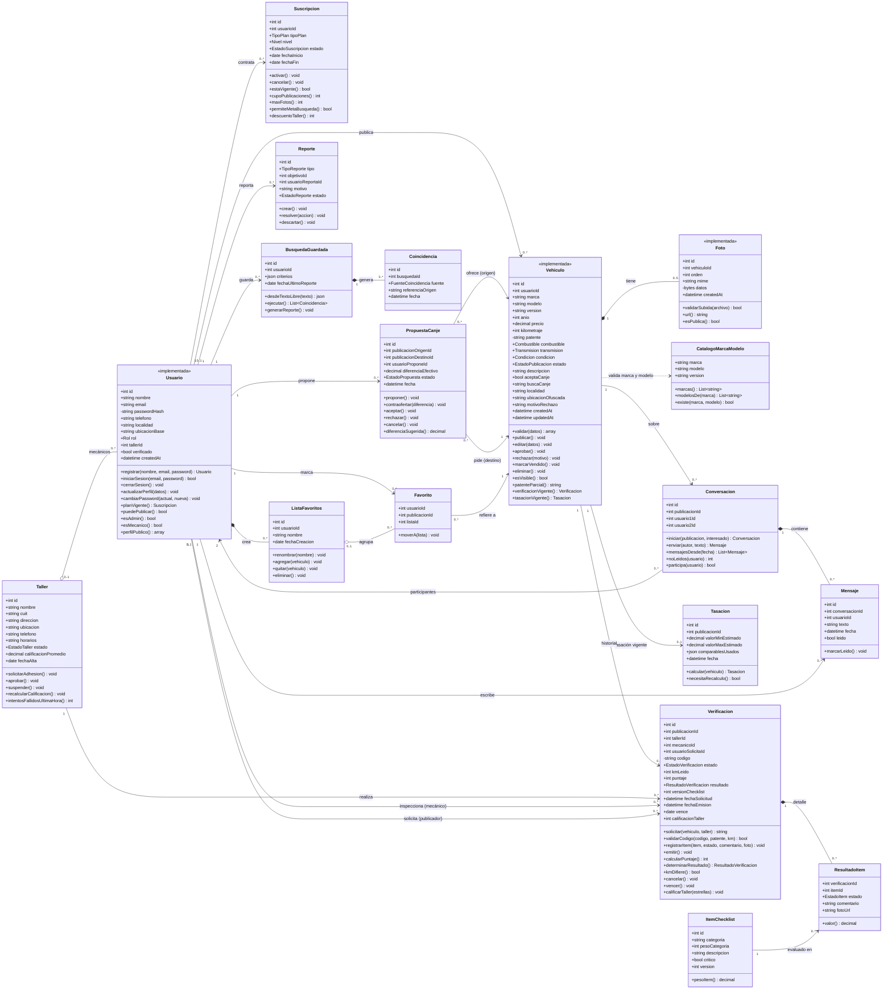
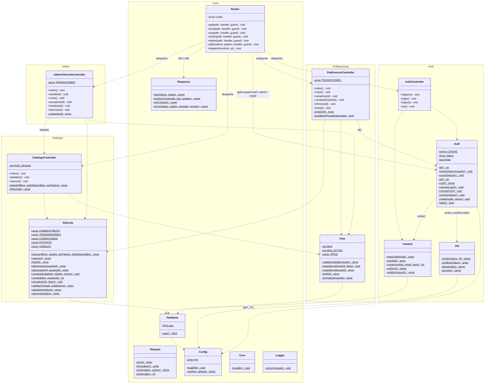

# Diagrama de clases UML — AutoCar

Bernal Justino · Marino Lautaro · Kasparian Federico · Programación en Ambiente Web · UNLu Mercedes · 2026

Este documento tiene tres diagramas:

1. **Modelo de dominio completo**: las 18 entidades de [arquitectura-y-modelo.md § 2](../Entrega_2/arquitectura-y-modelo.md#2-modelo-de-objetos-back-end) y [talleres-adheridos.md](../Entrega_2/talleres-adheridos.md), con atributos, métodos y relaciones (multiplicidad, composición, agregación).
2. **Enumeraciones** que usan los atributos del modelo.
3. **Clases implementadas en el back-end** ([AutoCarBackend/src](https://github.com/MateoPonti/AutoCarBackend)), tal como están hoy en el código PHP.

En el código la entidad *Publicación* se llama `Vehiculo` (tabla `vehiculo`), así que el diagrama usa ese nombre. Las entidades marcadas con `<<implementada>>` ya tienen tabla y API; las demás siguen en diseño y sus pantallas son maqueta.

---

## 1. Modelo de dominio

### Cómo leer las relaciones

| Símbolo | Significado | Ejemplo |
|---|---|---|
| `*--` (rombo lleno) | **Composición**: la parte no existe sin el todo y se borra con él | Al borrar un `Vehiculo` se borran sus `Foto` (`ON DELETE CASCADE`); un `Mensaje` sólo existe dentro de su `Conversacion` |
| `o--` (rombo vacío) | **Agregación**: la parte sobrevive al todo | Al eliminar una `ListaFavoritos` sus `Favorito` quedan sin lista ("Todos"); un mecánico sigue siendo usuario si el taller se suspende |
| `-->` | **Asociación** navegable con multiplicidad | `Usuario "0..1" --> "0..*" Vehiculo`: un vehículo cargado por el admin no tiene dueño (`usuario_id` NULL) |
| `..>` | **Dependencia** | `Vehiculo` consulta `CatalogoMarcaModelo` al validar |

### Reglas que el diagrama no puede expresar

- `Usuario` tiene **una sola** `Suscripcion` vigente a la vez; el resto es histórico.
- `Vehiculo` tiene como máximo **una** `Verificacion` activa (solicitada / en inspección) y **una** vigente (emitida y no vencida).
- La cantidad máxima de `Foto` depende del plan (hoy el back fija 5, `Foto::MAX`).
- `PropuestaCanje` sólo se puede crear si el vehículo destino tiene `aceptaCanje = true`.
- `Usuario.tallerId` sólo tiene valor si `rol = mecanico`.
- `Favorito` es la clase de asociación de la relación N a N entre `Usuario` y `Vehiculo`.

---

## 2. Enumeraciones

```mermaid
classDiagram
    direction LR
    class Rol {
        <<enumeration>>
        usuario
        mecanico
        admin
    }
    class TipoPlan {
        <<enumeration>>
        free
        metaSearching
        usoPortal
        ambas
    }
    class Nivel {
        <<enumeration>>
        bronce
        plata
        oro
        platino
    }
    class EstadoSuscripcion {
        <<enumeration>>
        activa
        vencida
        cancelada
    }
    class EstadoPublicacion {
        <<enumeration>>
        pendiente
        disponible
        rechazado
        vendido
        eliminado
    }
    class Combustible {
        <<enumeration>>
        nafta
        diesel
        gnc
        hibrido
        electrico
    }
    class Transmision {
        <<enumeration>>
        manual
        automatica
    }
    class Condicion {
        <<enumeration>>
        excelente
        muy_bueno
        bueno
        regular
    }
    class EstadoPropuesta {
        <<enumeration>>
        pendiente
        contraofertada
        aceptada
        rechazada
        cancelada
    }
    class FuenteCoincidencia {
        <<enumeration>>
        portal
        externa
    }
    class TipoReporte {
        <<enumeration>>
        publicacion
        usuario
        verificacion
    }
    class EstadoReporte {
        <<enumeration>>
        pendiente
        resuelto
        descartado
    }
    class EstadoTaller {
        <<enumeration>>
        pendiente
        activo
        suspendido
    }
    class EstadoVerificacion {
        <<enumeration>>
        solicitada
        en_inspeccion
        emitida
        cancelada
        vencida
    }
    class ResultadoVerificacion {
        <<enumeration>>
        muy_bueno
        bueno
        regular
        fallas_criticas
    }
    class EstadoItem {
        <<enumeration>>
        ok
        observado
        falla
    }
```

`EstadoSuscripcion` y `EstadoReporte` no tienen valores fijados en los documentos de diseño; los del diagrama son una propuesta.

---

## 3. Clases implementadas en el back-end (PHP)

Arquitectura en capas: `Router` → controladores → modelos (acceso a datos con PDO). Los modelos son clases `final` con métodos estáticos (en UML, subrayados; acá marcados con `$`).

### Rutas de la API por controlador

| Controlador | Método | Ruta | Guard |
|---|---|---|---|
| `CatalogoController` | `index` · `detalle` · `marcas` | `GET /api/vehiculos` · `GET /api/vehiculos/{id}` · `GET /api/marcas` | público |
| `PublicacionController` | `foto` | `GET /api/fotos/{id}` | público (controla visibilidad adentro) |
| `PublicacionController` | `index` · `crear` · `actualizar` · `cambiarEstado` · `eliminar` | `GET` · `POST /api/mis-vehiculos` · `PUT` · `PATCH …/{id}/estado` · `DELETE /api/mis-vehiculos/{id}` | `auth` + CSRF |
| `AuthController` | `registro` · `login` · `logout` · `me` | `POST /api/registro` · `POST /api/login` · `POST /api/logout` · `GET /api/me` | público · `me` con `auth` |
| `AdminVehiculoController` | `index` · `detalle` · `crear` · `actualizar` · `moderar` · `eliminar` | `/api/admin/vehiculos[/{id}[/estado]]` | `admin` + CSRF |
