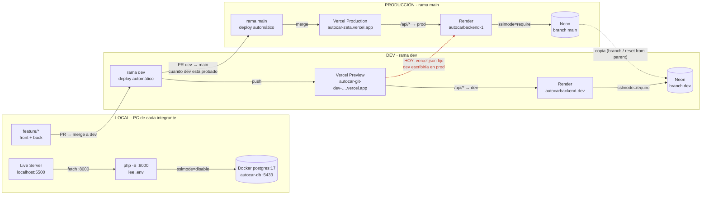
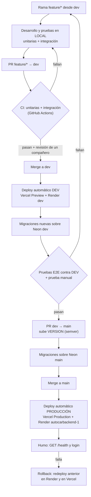
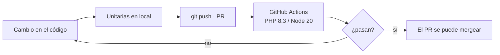
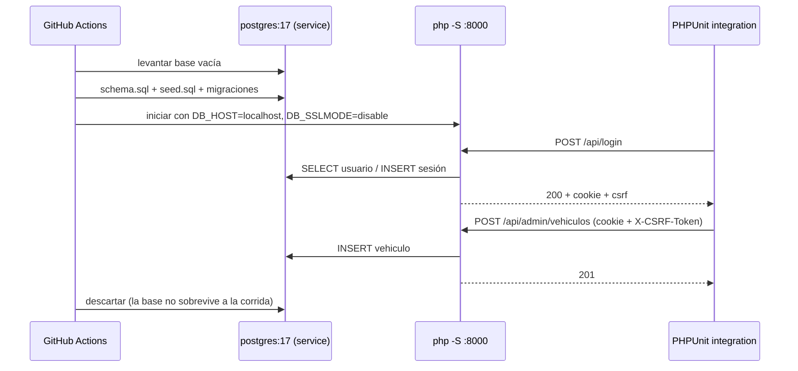
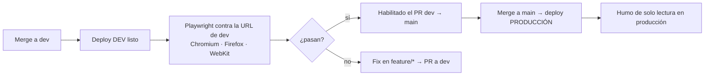

# Infraestructura — AutoCar

Bernal Justino · Marino Lautaro · Kasparian Federico · Ponti Mateo · Programación en Ambiente Web · UNLu Mercedes · 2026

Este documento registra cómo se organizan los entornos de AutoCar, qué decidimos y por qué. También define los flujos de deploy y de pruebas. Abarca los dos repos:

- **Front:** [AutoCar](https://github.com/Fedekasparian/AutoCar). HTML, CSS y JS nativo, sin build, publicado en Vercel.
- **Back:** [AutoCarBackend](https://github.com/MateoPonti/AutoCarBackend). API JSON en PHP 8.3 + Apache (Docker), publicada en Render, con PostgreSQL en Neon.

**Estado:** producción ya funciona. El entorno **dev** y los flujos de pruebas de las secciones 4 y 5 están **decididos pero falta implementarlos**. La sección 6 lista lo que queda pendiente.

---

## 1. Entornos

| Entorno | Rama | Front | API | Base de datos | Datos |
|---|---|---|---|---|---|
| **Local** | `feature/*` | Live Server · `localhost:5500` | `php -S localhost:8000` | Docker `postgres:17` · `autocar-db` · puerto 5433 | `schema.sql` + `seed.sql` |
| **Dev** (nuevo) | `dev` | Vercel Preview · `autocar-git-dev-….vercel.app` | Render · [autocarbackend-dev.onrender.com](https://autocarbackend-dev.onrender.com) | Neon · branch `dev` | Copia de producción |
| **Producción** | `main` | Vercel Production · [autocar-zeta.vercel.app](https://autocar-zeta.vercel.app) | Render · [autocarbackend-1.onrender.com](https://autocarbackend-1.onrender.com) | Neon · branch `main` | Reales |



Cada carril es una cadena completa con su front, su API y su base. El código sube de `feature/*` a `dev` y de `dev` a `main`. Vercel y Render despliegan cada uno desde su rama. La base de dev se llena con una copia de producción. La flecha roja es el problema que resuelve la decisión D4: hoy el `vercel.json` manda `/api` siempre a la API de producción, también desde el front de dev.

### Variables de entorno

| Variable | Local | Dev | Producción | Para qué |
|---|---|---|---|---|
| `DB_HOST` | `localhost` | `ep-…-dev.….neon.tech` | `ep-….….neon.tech` | Cada branch de Neon tiene su propio host |
| `DB_PORT` | `5433` | `5432` | `5432` | 5433 en local para no chocar con un Postgres instalado |
| `DB_NAME` | `autocar` | igual que producción | el actual | Neon copia la base con el mismo nombre |
| `DB_USER` / `DB_PASS` | `autocar` / `autocar` | rol propio de dev | rol de producción | Con un rol aparte, una clave filtrada de dev no abre producción |
| `DB_SSLMODE` | `disable` | `require` | `require` | Neon exige SSL y el Docker local no lo tiene |
| `FRONT_URL` | `http://localhost:5500` | `https://autocar-git-dev-….vercel.app` | `https://autocar-zeta.vercel.app` | Orígenes permitidos por CORS, separados por coma |
| `SESION_TTL` | `7200` | `7200` | `7200` | Duración de la sesión en segundos |
| `BACKEND_URL` *(front)* | no se usa | `https://autocarbackend-dev.onrender.com` | `https://autocarbackend-1.onrender.com` | La lee el middleware de Vercel (D4) |

**Dónde se carga cada una:**
- En local, en el `.env` del back, que no se sube al repo. El repo solo tiene `.env.example`.
- En dev y producción, en **Render → Environment** de cada servicio.
- `BACKEND_URL` va en **Vercel → Settings → Environment Variables**, marcada como *Preview* para la rama `dev` o *Production* para `main`.

`JWT_SECRET` y `JWT_TTL` solo existen en `main` del back. La rama `dev` pasó la sesión a `$_SESSION` guardada en la base. Cuando se mergee a `main` hay que borrar esas dos variables de Render y cargar `SESION_TTL`.

---

## 2. Decisiones

### D1. Tres entornos: local, dev y producción

**Decisión:** además de producción y de la PC de cada uno, sumamos un entorno **dev** en la nube que repite la misma cadena de producción (Vercel → Render → Neon).

**Por qué:** en local no se ven los problemas propios del despliegue: el proxy de Vercel, CORS con dominios reales, cookies `Secure`, SSL de Neon y el Dockerfile de Render. Dev permite probar todo eso y compartir una URL con el equipo o el docente sin arriesgar producción.

### D2. Una rama por entorno

**Decisión:** `main` = producción y `dev` = dev, en los dos repos. El trabajo diario va en `feature/*` (o `fix/*`, `docs/*`) y entra a `dev` por PR. A `main` solo llega un PR desde `dev`.

**Por qué:** el deploy queda atado a la rama, así que mergear es desplegar. Nadie despliega a mano y lo que está en `main` es siempre lo que se probó en `dev`.

### D3. Una base separada por entorno, con branches de Neon

**Decisión:**
- Dev usa una **branch `dev` de Neon** creada desde `main`, con host y rol propios.
- Local usa el Postgres de Docker del back (`docker compose up -d`).
- Las migraciones (`database/migracion-*.sql`) se corren **primero en dev** y en producción recién el día del merge.

**Por qué:**
- Una branch de Neon es una copia instantánea de producción, gratis en el plan actual. Se puede volver a copiar con *Reset from parent*, así que dev siempre tiene datos realistas.
- Las pruebas pueden crear y borrar publicaciones sin ensuciar datos reales.
- Ejemplo concreto: `migracion-sesion.sql` cambia el modelo de sesión y no puede llegar a producción antes que el código que la usa.

### D4. La URL del back sale de una variable de entorno de Vercel

**Decisión:** sacar el `rewrites` del `vercel.json` y reemplazarlo por un middleware de Vercel que reenvía `/api/*` a `BACKEND_URL`. Esa variable tiene un valor para Preview (dev) y otro para Production.

```js
// middleware.js (raíz del repo AutoCar) — necesita package.json con @vercel/functions
import { rewrite } from '@vercel/functions';

export const config = { matcher: '/api/:path*' };

export default function middleware(request) {
  const url = new URL(request.url);
  return rewrite(new URL(url.pathname + url.search, process.env.BACKEND_URL));
}
```

**Por qué:**
- El `vercel.json` es el mismo archivo en todas las ramas. Con la URL fija, el front de dev le pegaría a la API y a la base de producción.
- Tener un `vercel.json` distinto en `dev` no sirve, porque se pisaría al mergear a `main`.
- El front sigue pidiendo `/api/...` a su propio dominio, así que la cookie de sesión sigue siendo del propio sitio (no de terceros, que Safari bloquea) y `js/api/config.js` no cambia.

### D5. Secretos distintos por entorno y fuera del repo

**Decisión:** cada entorno tiene su propio rol y su propia clave de base. Ninguna clave real se commitea. Los valores viven en el `.env` local o en el panel de Render y Vercel.

**Por qué:** si se filtra una clave de dev, producción no queda expuesta. Y el historial de git no se puede limpiar después de subir una clave.

### D6. Un solo proyecto de Vercel y dos servicios de Render

**Decisión:** el front de dev es el *Preview deployment* de la rama `dev` en el mismo proyecto de Vercel, con una URL fija por rama. El back de dev es un segundo Web Service de Render con el mismo Dockerfile y *Branch: dev*.

**Por qué:**
- Vercel ya genera deploys Preview por rama sin costo.
- Render no tiene previews por rama en el plan gratuito, así que necesita un servicio aparte.
- El servicio dev del plan gratuito se duerme cuando no se usa. Para dev eso alcanza.

---

## 3. Flujo de deploy



**Reglas:**

1. **Nadie pushea directo a `main` ni a `dev`.** Todo entra por PR. En GitHub, ambas ramas se protegen con *Require a pull request* y *Require status checks*.
2. **Orden entre repos.** Si un cambio toca front y back, primero se mergea el back. Así el front nuevo nunca llama a un endpoint que todavía no existe. Esto vale en `dev` y en `main`.
3. **Migraciones antes del código.** Una migración se aplica a la base antes del merge que la necesita. Las migraciones tienen que ser compatibles con el código anterior: agregar columnas o tablas, no borrarlas en el mismo release.
4. **Versión.** Cada PR `dev → main` sube el archivo `VERSION` (semver) del repo que cambia y se etiqueta el merge (`git tag vX.Y.Z`).
5. **Rollback.**
   - Render: *Deploys → Rollback* al deploy anterior.
   - Vercel: *Deployments → Promote to Production* sobre el anterior.
   - Una migración no se deshace sola: si hace falta, se escribe la migración inversa.
6. **Resincronizar dev.** Después de cada release, o cuando los datos de dev se ensucien, se hace *Reset from parent* sobre la branch `dev` de Neon. Esto borra los datos de dev.

---

## 4. Pruebas unitarias

Prueban una pieza aislada, sin base, sin red y sin navegador. Son rápidas y corren en cada PR.

| | Back | Front |
|---|---|---|
| **Herramienta** | PHPUnit (`require-dev` en `composer.json`) | `node --test` (Node 20+, sin dependencias) |
| **Dónde** | `AutoCarBackend/tests/Unit/` | `AutoCar/tests/unit/` |
| **Qué cubren** | Validaciones (`Vehiculo`, `Foto::MAX_BYTES`, email y contraseña), `Config::get` con y sin `.env`, armado de CORS desde `FRONT_URL`, permisos por rol | Funciones puras de `front/js/servicios/`: rutas, formateo de precios y kilómetros, validaciones de formularios, armado de URLs en `api/cliente.js` |
| **Comando** | `vendor/bin/phpunit --testsuite unit` | `node --test tests/unit/` |
| **Cuándo** | En local antes del PR y en CI en cada PR a `dev` y a `main` | Igual |



---

## 5. Pruebas de integración y de punta a punta

### 5.1 Integración (API + base real)

Prueban la API completa contra un PostgreSQL real: router, controladores, SQL y sesión. Cada prueba hace pedidos HTTP y revisa el código de estado y el JSON.

- **Herramienta:** PHPUnit (`--testsuite integration`) con un cliente HTTP.
- **Base:** siempre una base descartable, **nunca Neon**. En local es el Docker del back. En CI es un *service container* `postgres:17` que se crea vacío y carga `schema.sql` + `seed.sql` + migraciones en cada corrida.
- **API:** `php -S localhost:8000 -t public` con `DB_SSLMODE=disable`.
- **Casos mínimos:**
  - registro y login: `201`, cookie de sesión y `csrf`;
  - `GET /api/me` sin sesión: `401`;
  - alta, edición y baja de un vehículo como admin, cada una con su código de estado;
  - las mismas operaciones como `usuario`: `403`;
  - `POST` sin `X-CSRF-Token`: `403`;
  - datos inválidos: `422` con `errores` por campo;
  - filtros de `GET /api/vehiculos` (`q`, `marca`, `precio_max`, `page`);
  - CORS: un origen que no está en `FRONT_URL` no recibe `Access-Control-Allow-Origin`.
- **Cuándo:** en CI en cada PR del back a `dev` y a `main`, después de las unitarias.



### 5.2 Punta a punta (desde el lado del usuario)

Prueban la aplicación como la usa una persona: un navegador real abre el front, completa formularios y verifica lo que ve. Atraviesan front, proxy de Vercel, API y base.

- **Herramienta:** Playwright (Chromium, Firefox y WebKit; WebKit cubre el caso de Safari con las cookies). Como alternativa vista en la materia está Selenium WebDriver.
- **Dónde:** `AutoCar/tests/e2e/`.
- **Contra qué:** la **URL de dev** (`BASE_URL=https://autocar-git-dev-….vercel.app`), con un usuario admin y un usuario común de prueba que existen solo en Neon dev. **Nunca contra producción**, porque las pruebas crean y borran datos.
- **Recorridos mínimos:**
  1. buscar y filtrar vehículos, y abrir un detalle;
  2. registrarse, iniciar sesión y cerrarla;
  3. como admin: publicar un vehículo con foto, editarlo y darlo de baja;
  4. enviar un mensaje en el chat con texto que intente XSS y verificar que no se ejecute. Hoy esto lo cubre a mano `tests/mensajes-xss.html` y pasaría a Playwright.
- **Cuándo:** después de cada deploy a dev (disparo manual o con `workflow_dispatch`) y siempre antes de abrir el PR `dev → main`.
- **En producción** solo se corre una prueba de humo que no escribe datos: `GET /health`, que cargue la portada y que liste vehículos.



### Resumen de la pirámide

| Nivel | Qué atraviesa | Base | Dónde corre | Cuándo |
|---|---|---|---|---|
| Unitarias | Una función o clase | Ninguna | Local + CI | Cada PR |
| Integración | API completa | Postgres descartable (Docker / CI) | Local + CI | Cada PR del back |
| Punta a punta | Navegador → Vercel → Render → Neon | Neon dev | Contra el entorno dev | Después del deploy a dev y antes del PR a `main` |
| Humo | Lectura pública | Neon main | Contra producción | Después de cada deploy a `main` |

---

## 6. Pendientes para implementar

- [ ] Neon: crear la branch `dev` y un rol propio, y correr `migracion-sesion.sql` sobre ella.
- [x] Render: crear el Web Service `autocarbackend-dev` ([autocarbackend-dev.onrender.com](https://autocarbackend-dev.onrender.com)) con *Branch: dev* y las variables de la sección 1.
- [ ] Front: agregar `middleware.js` + `package.json`, sacar `rewrites` de `vercel.json` y cargar `BACKEND_URL` en Vercel para Preview y Production (D4).
- [ ] Render dev: poner en `FRONT_URL` la URL de rama de Vercel (`autocar-git-dev-….vercel.app`).
- [ ] GitHub: proteger `main` y `dev` en los dos repos (PR obligatorio + checks).
- [ ] Back: agregar PHPUnit (`require-dev`), las carpetas `tests/Unit` y `tests/Integration`, y el workflow `.github/workflows/ci.yml` con el service `postgres:17`.
- [ ] Front: agregar `tests/unit` (`node --test`), `tests/e2e` (Playwright) y su workflow.
- [ ] Cuando se mergee `dev → main` en el back: borrar `JWT_SECRET` y `JWT_TTL` de Render producción y cargar `SESION_TTL`.
