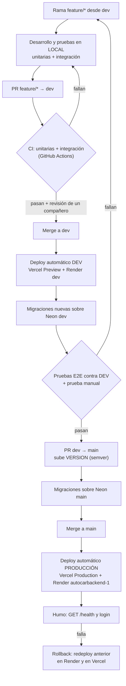
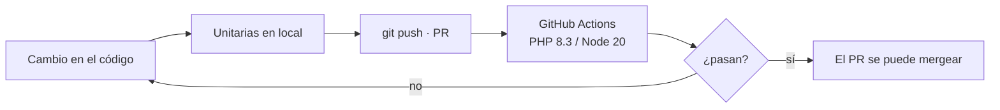
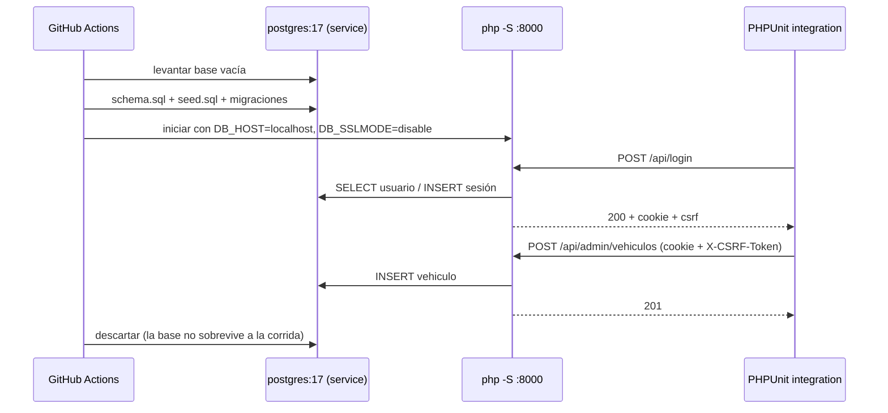
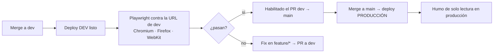

# Infraestructura — AutoCar

Bernal Justino · Marino Lautaro · Kasparian Federico · Ponti Mateo · Programación en Ambiente Web · UNLu Mercedes · 2026

Este documento registra cómo se organizan los entornos de AutoCar, qué decidimos y por qué. También define los flujos de deploy y de pruebas. Abarca los dos repos:

- **Front:** [AutoCar](https://github.com/Fedekasparian/AutoCar). HTML, CSS y JS nativo, sin build, publicado en Vercel.
- **Back:** [AutoCarBackend](https://github.com/MateoPonti/AutoCarBackend). API JSON en PHP 8.3 + Apache (Docker), publicada en Render, con PostgreSQL en Neon.

**Estado:** producción ya funciona. El código del entorno **dev** y de las pruebas de las secciones 4 y 5 ya está en la rama `dev` de los dos repos. Falta configurar Neon, Render y Vercel: la sección 6 tiene el paso a paso.

---

## 1. Entornos

| Entorno | Rama | Front | API | Base de datos | Datos |
|---|---|---|---|---|---|
| **Local** | `feature/*` | Live Server · `localhost:5500` | `php -S localhost:8000` | Docker `postgres:17` · `autocar-db` · puerto 5433 | `schema.sql` + `seed.sql` |
| **Dev** (nuevo) | `dev` | Vercel Preview · `autocar-git-dev-….vercel.app` | Render · [autocarbackend-dev.onrender.com](https://autocarbackend-dev.onrender.com) | Neon · **proyecto de dev** (aparte) | De prueba |
| **Producción** | `main` | Vercel Production · [autocar-zeta.vercel.app](https://autocar-zeta.vercel.app) | Render · [autocarbackend-1.onrender.com](https://autocarbackend-1.onrender.com) | Neon · **proyecto de producción** | Reales |

```mermaid
flowchart LR
    subgraph LOCAL["LOCAL · PC de cada integrante"]
        direction LR
        LC["feature/*<br/>front + back"]
        LF["Live Server<br/>localhost:5500"]
        LA["php -S :8000<br/>lee .env"]
        LD[("Docker postgres:17<br/>autocar-db :5433")]
        LF -- "fetch :8000" --> LA
        LA -- "sslmode=disable" --> LD
    end

    subgraph DEV["DEV · rama dev"]
        direction LR
        DC["rama dev<br/>deploy automático"]
        DF["Vercel Preview<br/>autocar-git-dev-….vercel.app"]
        DA["Render<br/>autocarbackend-dev"]
        DD[("Neon<br/>proyecto dev")]
        DC -- "push" --> DF
        DF -- "/api/* → dev" --> DA
        DA -- "sslmode=require" --> DD
    end

    subgraph PROD["PRODUCCIÓN · rama main"]
        direction LR
        PC["rama main<br/>deploy automático"]
        PF["Vercel Production<br/>autocar-zeta.vercel.app"]
        PA["Render<br/>autocarbackend-1"]
        PD[("Neon<br/>proyecto main")]
        PC -- "merge" --> PF
        PF -- "/api/* → prod" --> PA
        PA -- "sslmode=require" --> PD
    end

    LC -- "PR → merge a dev" --> DC
    DC -- "PR dev → main<br/>cuando dev está probado" --> PC
    DF -. "HOY: vercel.json fijo<br/>dev escribiría en prod" .-> PA

    linkStyle 11 stroke:#c23b2a,stroke-width:2px,color:#c23b2a
```

Cada carril es una cadena completa con su front, su API y su base. El código sube de `feature/*` a `dev` y de `dev` a `main`. Vercel y Render despliegan cada uno desde su rama. La base de dev se llena con una copia de producción. La flecha roja es el problema que resuelve la decisión D4: hoy el `vercel.json` manda `/api` siempre a la API de producción, también desde el front de dev.

### Variables de entorno

| Variable | Local | Dev | Producción | Para qué |
|---|---|---|---|---|
| `DB_HOST` | `localhost` | `ep-…-dev.….neon.tech` | `ep-….….neon.tech` | Cada proyecto de Neon tiene su propio host |
| `DB_PORT` | `5433` | `5432` | `5432` | 5433 en local para no chocar con un Postgres instalado |
| `DB_NAME` | `autocar` | igual que producción | el actual | Neon copia la base con el mismo nombre |
| `DB_USER` / `DB_PASS` | `autocar` / `autocar` | rol propio de dev | rol de producción | Con un rol aparte, una clave filtrada de dev no abre producción |
| `DB_SSLMODE` | `disable` | `require` | `require` | Neon exige SSL y el Docker local no lo tiene |
| `FRONT_URL` | `http://localhost:5500` | `https://autocar-git-dev-….vercel.app` | `https://autocar-zeta.vercel.app` | Orígenes permitidos por CORS, separados por coma |
| `SESION_TTL` | `7200` | `7200` | `7200` | Duración de la sesión en segundos |
| `BACKEND_URL` *(front)* | no se usa | `https://autocarbackend-dev.onrender.com` | `https://autocarbackend-1.onrender.com` | La lee el middleware de Vercel (D4) |

**Dónde se carga cada una:**
- En local, en el `.env` del back, que no se sube al repo. El repo solo tiene `.env.example`.
- En dev y producción, en **Render → Environment** de cada servicio.
- `BACKEND_URL` va en **Vercel → Settings → Environment Variables**, marcada como *Preview* para la rama `dev` o *Production* para `main`.

La sesión es `$_SESSION` guardada en la base en los dos entornos: `JWT_SECRET` y `JWT_TTL` ya no se usan.

---

## 2. Decisiones

### D1. Tres entornos: local, dev y producción

**Decisión:** además de producción y de la PC de cada uno, sumamos un entorno **dev** en la nube que repite la misma cadena de producción (Vercel → Render → Neon).

**Por qué:** en local no se ven los problemas propios del despliegue: el proxy de Vercel, CORS con dominios reales, cookies `Secure`, SSL de Neon y el Dockerfile de Render. Dev permite probar todo eso y compartir una URL con el equipo o el docente sin arriesgar producción.

### D2. Una rama por entorno

**Decisión:** `main` = producción y `dev` = dev, en los dos repos. El trabajo diario va en `feature/*` (o `fix/*`, `docs/*`) y entra a `dev` por PR. A `main` solo llega un PR desde `dev`.

**Por qué:** el deploy queda atado a la rama, así que mergear es desplegar. Nadie despliega a mano y lo que está en `main` es siempre lo que se probó en `dev`.

### D3. Una base separada por entorno: dos proyectos de Neon

> **Cómo quedó en la práctica (08/11):** en vez de una *branch* `dev` dentro del proyecto de producción, se usan **dos proyectos de Neon separados**, uno para producción y otro para dev, cada uno con su host. Funciona igual para este flujo y es todavía más difícil tocar producción por error. Lo que cambia: los datos de dev no son una copia de producción (no hay *Reset from parent*) y cada migración se corre en el SQL Editor de cada proyecto. Lo que sigue sobre branches (D3 original, paso 1 y el paso 6 de "Resincronizar dev") queda como alternativa.

**Decisión:**
- Dev usa **su propio proyecto de Neon** (al principio se pensó como una branch `dev` creada desde `main`), con host y rol propios.
- Local usa el Postgres de Docker del back (`docker compose up -d`).
- Las migraciones (`database/NNN-*.sql`, numeradas en el orden en que se corren) se corren **primero en dev** y en producción recién el día del merge.

**Por qué:**
- Una branch de Neon es una copia instantánea de producción, gratis en el plan actual. Se puede volver a copiar con *Reset from parent*, así que dev siempre tiene datos realistas.
- Las pruebas pueden crear y borrar publicaciones sin ensuciar datos reales.
- Ejemplo concreto: `004-sesion.sql` cambia el modelo de sesión y no puede llegar a producción antes que el código que la usa.

### D4. La URL del back sale de una variable de entorno de Vercel

**Decisión:** sacar el `rewrites` del `vercel.json` y reemplazarlo por un middleware de Vercel que reenvía `/api/*` a `BACKEND_URL`. Esa variable tiene un valor para Preview (dev) y otro para Production.

```js
// middleware.js (raíz del repo AutoCar) — necesita package.json con @vercel/functions
import { rewrite } from '@vercel/functions';

export const config = { matcher: '/api/:path*' };

export default function middleware(request) {
  const url = new URL(request.url);
  return rewrite(new URL(url.pathname + url.search, process.env.BACKEND_URL));
}
```

**Por qué:**
- El `vercel.json` es el mismo archivo en todas las ramas. Con la URL fija, el front de dev le pegaría a la API y a la base de producción.
- Tener un `vercel.json` distinto en `dev` no sirve, porque se pisaría al mergear a `main`.
- El front sigue pidiendo `/api/...` a su propio dominio, así que la cookie de sesión sigue siendo del propio sitio (no de terceros, que Safari bloquea) y `js/api/config.js` no cambia.

### D5. Secretos distintos por entorno y fuera del repo

**Decisión:** cada entorno tiene su propio rol y su propia clave de base. Ninguna clave real se commitea. Los valores viven en el `.env` local o en el panel de Render y Vercel.

**Por qué:** si se filtra una clave de dev, producción no queda expuesta. Y el historial de git no se puede limpiar después de subir una clave.

### D6. Un solo proyecto de Vercel y dos servicios de Render

**Decisión:** el front de dev es el *Preview deployment* de la rama `dev` en el mismo proyecto de Vercel, con una URL fija por rama. El back de dev es un segundo Web Service de Render con el mismo Dockerfile y *Branch: dev*.

**Por qué:**
- Vercel ya genera deploys Preview por rama sin costo.
- Render no tiene previews por rama en el plan gratuito, así que necesita un servicio aparte.
- El servicio dev del plan gratuito se duerme cuando no se usa. Para dev eso alcanza.

---

## 3. Flujo de deploy



**Reglas:**

1. **Nadie pushea directo a `main` ni a `dev`.** Todo entra por PR. En GitHub, ambas ramas se protegen con *Require a pull request* y *Require status checks*.
2. **Orden entre repos.** Si un cambio toca front y back, primero se mergea el back. Así el front nuevo nunca llama a un endpoint que todavía no existe. Esto vale en `dev` y en `main`.
3. **Migraciones antes del código.** Una migración se aplica a la base antes del merge que la necesita. Las migraciones tienen que ser compatibles con el código anterior: agregar columnas o tablas, no borrarlas en el mismo release.
4. **Versión.** Cada PR `dev → main` sube el archivo `VERSION` (semver) del repo que cambia y se etiqueta el merge (`git tag vX.Y.Z`).
5. **Rollback.**
   - Render: *Deploys → Rollback* al deploy anterior.
   - Vercel: *Deployments → Promote to Production* sobre el anterior.
   - Una migración no se deshace sola: si hace falta, se escribe la migración inversa.
6. **Resincronizar dev.** Después de cada release, o cuando los datos de dev se ensucien, se hace *Reset from parent* sobre la branch `dev` de Neon. Esto borra los datos de dev.

---

## 4. Pruebas unitarias

Prueban una pieza aislada, sin base, sin red y sin navegador. Son rápidas y corren en cada PR.

| | Back | Front |
|---|---|---|
| **Herramienta** | PHPUnit (`require-dev` en `composer.json`) | `node --test` (Node 20+, sin dependencias) |
| **Dónde** | `AutoCarBackend/tests/Unit/` | `AutoCar/tests/unit/` |
| **Qué cubren** | Validaciones (`Vehiculo`, `Foto::MAX_BYTES`, email y contraseña), `Config::get` con y sin `.env`, armado de CORS desde `FRONT_URL`, permisos por rol | Funciones puras de `front/js/servicios/`: rutas, formateo de precios y kilómetros, validaciones de formularios, armado de URLs en `api/cliente.js` |
| **Comando** | `vendor/bin/phpunit --testsuite unit` | `node --test tests/unit/` |
| **Cuándo** | En local antes del PR y en CI en cada PR a `dev` y a `main` | Igual |



---

## 5. Pruebas de integración y de punta a punta

### 5.1 Integración (API + base real)

Prueban la API completa contra un PostgreSQL real: router, controladores, SQL y sesión. Cada prueba hace pedidos HTTP y revisa el código de estado y el JSON.

- **Herramienta:** PHPUnit (`--testsuite integration`) con un cliente HTTP.
- **Base:** siempre una base descartable, **nunca Neon**. En local es el Docker del back. En CI es un *service container* `postgres:17` que se crea vacío y carga `schema.sql` + `seed.sql` + migraciones en cada corrida.
- **API:** `php -S localhost:8000 -t public` con `DB_SSLMODE=disable`.
- **Casos mínimos:**
  - registro y login: `201`, cookie de sesión y `csrf`;
  - `GET /api/me` sin sesión: `401`;
  - alta, edición y baja de un vehículo como admin, cada una con su código de estado;
  - las mismas operaciones como `usuario`: `403`;
  - `POST` sin `X-CSRF-Token`: `403`;
  - datos inválidos: `422` con `errores` por campo;
  - filtros de `GET /api/vehiculos` (`q`, `marca`, `precio_max`, `page`);
  - CORS: un origen que no está en `FRONT_URL` no recibe `Access-Control-Allow-Origin`.
- **Cuándo:** en CI en cada PR del back a `dev` y a `main`, después de las unitarias.



### 5.2 Punta a punta (desde el lado del usuario)

Prueban la aplicación como la usa una persona: un navegador real abre el front, completa formularios y verifica lo que ve. Atraviesan front, proxy de Vercel, API y base.

- **Herramienta:** Playwright (Chromium, Firefox y WebKit; WebKit cubre el caso de Safari con las cookies). Como alternativa vista en la materia está Selenium WebDriver.
- **Dónde:** `AutoCar/tests/e2e/`.
- **Contra qué:** la **URL de dev** (`BASE_URL=https://autocar-git-dev-….vercel.app`), con un usuario admin y un usuario común de prueba que existen solo en Neon dev. **Nunca contra producción**, porque las pruebas crean y borran datos.
- **Recorridos mínimos:**
  1. buscar y filtrar vehículos, y abrir un detalle;
  2. registrarse, iniciar sesión y cerrarla;
  3. como admin: publicar un vehículo con foto, editarlo y darlo de baja;
  4. enviar un mensaje en el chat con texto que intente XSS y verificar que no se ejecute. Hoy esto lo cubre a mano `tests/mensajes-xss.html` y pasaría a Playwright.
- **Cuándo:** después de cada deploy a dev (disparo manual o con `workflow_dispatch`) y siempre antes de abrir el PR `dev → main`.
- **En producción** solo se corre una prueba de humo que no escribe datos: `GET /health`, que cargue la portada y que liste vehículos.



### Resumen de la pirámide

| Nivel | Qué atraviesa | Base | Dónde corre | Cuándo |
|---|---|---|---|---|
| Unitarias | Una función o clase | Ninguna | Local + CI | Cada PR |
| Integración | API completa | Postgres descartable (Docker / CI) | Local + CI | Cada PR del back |
| Punta a punta | Navegador → Vercel → Render → Neon | Neon dev | Contra el entorno dev | Después del deploy a dev y antes del PR a `main` |
| Humo | Lectura pública | Neon main | Contra producción | Después de cada deploy a `main` |

---

## 6. Pendientes para implementar

Estado al 6/11/2026. El código de la infraestructura ya está en `dev` en los dos repos: front PR #7 y back PR #1. Lo que falta es configuración en los paneles de Neon, Render, Vercel y GitHub. El paso a paso está en la sección 6.1.

**Hecho**

- [x] Render: crear el Web Service `autocarbackend-dev` ([autocarbackend-dev.onrender.com](https://autocarbackend-dev.onrender.com)) con *Branch: dev*.
- [x] Front: `middleware.js` + `package.json`, sin `rewrites` en `vercel.json` (D4). Mergeado a `dev`.
- [x] Back: PHPUnit (`require-dev`), `tests/Unit`, `tests/Integration` y `.github/workflows/ci.yml` con el service `postgres:17`. Mergeado a `dev`.
- [x] Front: `tests/unit` (`node --test`), `tests/e2e` (Playwright) y los workflows `ci.yml` y `e2e.yml`. Mergeado a `dev`.
- [x] GitHub: proteger `main` y `dev` en **AutoCar** (PR con 1 aprobación + check `unitarias`, sin force push ni borrado).

**Falta**

- [x] Neon: base de dev (hecho con un proyecto aparte, no con una branch; ver D3).
- [ ] Render dev: cargar las variables de la base dev y `FRONT_URL` (paso 2). Hoy `/health` da 200 pero `/api/vehiculos` da 500 porque no tiene base.
- [ ] Vercel: cargar `BACKEND_URL` para Preview y para Production (paso 3). Sin esa variable, `/api` da 503.
- [ ] Vercel: resolver la *Deployment Protection* de los Preview (paso 4). Hoy piden login de Vercel, y así el E2E y el docente no pueden entrar a dev.
- [ ] GitHub: proteger `main` y `dev` en **AutoCarBackend** (paso 5). Lo tiene que hacer MateoPonti, que es el admin.
- [ ] Render producción: borrar `JWT_SECRET` y `JWT_TTL` y cargar `SESION_TTL` (paso 6). La sesión con `$_SESSION` ya está en `main` del back.
- [ ] Primer release `dev → main` del front, una vez cargado `BACKEND_URL` en Production (paso 7).

### 6.1 Paso a paso

El orden importa: cada paso necesita el anterior.

#### Paso 1 · Neon: base de dev

> Se terminó haciendo con **un proyecto de Neon aparte** para dev (ver D3). Si se rehace, alcanza con crear el proyecto, correr `schema.sql` y cargar sus datos en Render dev; los pasos de abajo son para la alternativa con branch.

1. Entrar a [console.neon.tech](https://console.neon.tech) y abrir el proyecto de AutoCar.
2. **Branches → New branch.**
   - *Name:* `dev`.
   - *Parent:* `main`.
   - *Include data up to:* **Current point in time**.
   - Crear la branch. Queda una copia de producción con su propio host (`ep-…`).
3. **Roles** (con la branch `dev` seleccionada arriba) **→ New role** → nombre `autocar_dev`. Copiar la contraseña que muestra **una sola vez**.
4. **SQL Editor**, con la branch `dev` seleccionada. Darle permisos al rol nuevo. Si el nombre de la base no es `neondb`, cambiarlo en el `GRANT CONNECT`:
   ```sql
   GRANT CONNECT ON DATABASE neondb TO autocar_dev;
   GRANT USAGE ON SCHEMA public TO autocar_dev;
   GRANT SELECT, INSERT, UPDATE, DELETE ON ALL TABLES IN SCHEMA public TO autocar_dev;
   GRANT USAGE, SELECT ON ALL SEQUENCES IN SCHEMA public TO autocar_dev;
   ALTER DEFAULT PRIVILEGES IN SCHEMA public GRANT SELECT, INSERT, UPDATE, DELETE ON TABLES TO autocar_dev;
   ALTER DEFAULT PRIVILEGES IN SCHEMA public GRANT USAGE, SELECT ON SEQUENCES TO autocar_dev;
   ```
5. En el mismo SQL Editor, sobre la branch `dev`, correr las migraciones de `AutoCarBackend/database/`. Hay que copiar y pegar cada archivo completo, en este orden. Todas se pueden volver a correr sin romper nada:
   1. `001-e4.sql`
   2. `002-nombres.sql`
   3. `003-chat.sql`
   4. `004-sesion.sql`
   5. `005-roles.sql`
   6. `006-inspecciones.sql`
   7. `007-demo-inspecciones-solo-dev.sql` (solo en `dev`: mecánicos de ejemplo)
   8. `008-separar-version.sql`
   9. `009-solicitud-taller.sql`
   10. `010-publicar-por-partes.sql`

   El número del archivo es el orden. Las migraciones nuevas siguen con `011-...`.
6. Verificar en el SQL Editor (`dev`):
   ```sql
   SELECT to_regclass('public.sesion'), to_regclass('public.rol'), to_regclass('public.conversacion');
   SELECT count(*) FROM vehiculo;
   ```
   No tiene que aparecer ningún `NULL`, y la cantidad de vehículos tiene que ser la misma que en producción.
7. Botón **Connect**, con la branch `dev`, el rol `autocar_dev` y **Connection pooling desactivado**. Anotar el host, la base, el usuario y la contraseña para el paso 2. **No pegarlos en el repo, ni en issues, ni en el chat.**

> Las migraciones ya tienen que estar aplicadas en `main` de Neon, porque producción ya corre el back con roles y sesiones. Para verificarlo, correr la consulta del punto 6 sobre `main`. Si alguna da `NULL`, correr la migración que falta también sobre `main`.

#### Paso 2 · Render: back de dev

1. En [dashboard.render.com](https://dashboard.render.com), abrir el servicio **autocarbackend-dev** → **Environment**.
2. Cargar o reemplazar estas variables:

   | Variable | Valor |
   |---|---|
   | `DB_HOST` | host de la branch `dev` (`ep-…`, el del paso 1.7) |
   | `DB_PORT` | `5432` |
   | `DB_NAME` | el de la branch `dev` (el mismo nombre que en producción) |
   | `DB_USER` | `autocar_dev` |
   | `DB_PASS` | la contraseña del paso 1.3 |
   | `DB_SSLMODE` | `require` |
   | `SESION_TTL` | `7200` |
   | `FRONT_URL` | `https://autocar-git-dev-autocar4.vercel.app` |

   Si el servicio tiene `JWT_SECRET` o `JWT_TTL`, borrarlas.
3. **Save, rebuild and deploy.** En **Settings**, confirmar que *Branch* sea `dev` y que *Auto-Deploy* esté en *On Commit*.
4. Cuando termine el deploy, probar:
   ```bash
   curl https://autocarbackend-dev.onrender.com/health          # {"estado":"ok"}
   curl https://autocarbackend-dev.onrender.com/api/vehiculos   # 200 con "items"
   ```
   Si sigue dando 500, mirar **Logs**. Lo más común es una clave mal copiada o el host del pooler (`-pooler`) en lugar del directo.

#### Paso 3 · Vercel: `BACKEND_URL` por entorno

Lo tiene que hacer alguien con acceso al team **autocar4**. Otra opción es sumar al resto como miembros: *Team Settings → Members → Invite*.

1. Entrar a [vercel.com/autocar4/autocar](https://vercel.com/autocar4/autocar) → **Settings → Environment Variables → Add New**.
2. Primera variable:
   - *Key:* `BACKEND_URL`.
   - *Value:* `https://autocarbackend-1.onrender.com`.
   - *Environments:* solo **Production**.
   - **Save**.
3. Segunda variable:
   - *Key:* `BACKEND_URL`.
   - *Value:* `https://autocarbackend-dev.onrender.com`.
   - *Environments:* solo **Preview**, todas las ramas. Así los Preview de `feature/*` también usan el back de dev.
   - **Save**.
4. Las variables se leen al desplegar. Hay que ir a **Deployments**, buscar el último deploy de la rama `dev` y elegir **⋯ → Redeploy**.
5. Probar: `https://autocar-git-dev-autocar4.vercel.app/api/vehiculos` tiene que devolver la lista de vehículos y no `sin_backend`. Si los Preview están protegidos, hacé esta prueba logueado en Vercel o después del paso 4.

#### Paso 4 · Vercel: protección de los Preview

Hoy los Preview responden 302 y mandan al login de Vercel. Elegir una de las dos opciones:

- **A. Dev público.** Es lo más simple si el docente tiene que poder entrar. Ir a *Settings → Deployment Protection → Vercel Authentication* → **Disabled**, o *Only Production Deployments* si está disponible. El E2E no necesita nada más.
- **B. Dev privado con bypass para el E2E.**
  1. *Settings → Deployment Protection → Protection Bypass for Automation* → **Add Secret**, y copiar el valor.
  2. En GitHub, ir a **Fedekasparian/AutoCar → Settings → Secrets and variables → Actions → New repository secret**. Nombre: `VERCEL_AUTOMATION_BYPASS_SECRET`, con el valor del punto anterior.
  3. `playwright.config.js` ya manda ese header cuando existe el secreto.

Para comprobarlo, ir a **Actions → E2E → Run workflow**. Poner `base_url` = `https://autocar-git-dev-autocar4.vercel.app` y destildar *solo_humo*. Tiene que pasar en Chromium, Firefox y WebKit.

#### Paso 5 · GitHub: proteger las ramas del back

Lo tiene que hacer **MateoPonti**, que es el admin de `MateoPonti/AutoCarBackend`.

1. **Settings → Branches → Add classic branch protection rule**, una regla para `main` y otra para `dev`.
2. Tildar:
   - **Require a pull request before merging**, con *Required approvals: 1*.
   - **Require status checks to pass before merging**, buscando y agregando `pruebas` e `imagen`.
   - Dejar sin tildar *Allow force pushes* y *Allow deletions*.
3. **Create.** Con `gh` es lo mismo que se hizo en el front: `gh api -X PUT repos/MateoPonti/AutoCarBackend/branches/<rama>/protection --input proteccion.json`. El archivo `proteccion.json` lleva los checks `pruebas` e `imagen` y `required_approving_review_count: 1`.

#### Paso 6 · Render: limpiar producción

1. Servicio **autocarbackend-1** → **Environment**.
2. Borrar `JWT_SECRET` y `JWT_TTL`.
3. Agregar `SESION_TTL` = `7200`.
4. **Save, rebuild and deploy**.
5. Hacer la prueba de humo: `GET /health`, y entrar y salir con una cuenta real en [autocar-zeta.vercel.app](https://autocar-zeta.vercel.app/front/index.html).

#### Paso 7 · Primer release del front a producción

Recién después del paso 3, porque sin `BACKEND_URL` en Production, producción da 503 en `/api`:

1. Correr el E2E contra dev (paso 4) y probar a mano: login, publicar un vehículo y el chat.
2. Subir `VERSION` en una rama, abrir el PR `dev → main` y esperar el check `unitarias` y una aprobación.
3. Mergear y etiquetar la versión: `git tag vX.Y.Z && git push --tags`.
4. Vercel despliega Production y el workflow E2E corre solo las pruebas `@humo`. Verificar que [autocar-zeta.vercel.app/api/vehiculos](https://autocar-zeta.vercel.app/api/vehiculos) siga respondiendo.
5. Si algo falla: Vercel → *Deployments* → deploy anterior → **Promote to Production**.

## Notas (10/11/2026)

- **Render dev tiene que desplegar la rama `dev`** (Settings → Build & Deploy → Branch). El 10/11 apareció en `main` y no tomaba nada de dev. Prueba rápida: `POST /api/admin/vehiculos` sin sesión responde 405 con el código nuevo.
- **Firestore (NoSQL):** dos proyectos de Firebase, `autocar-dev` y `autocar-9897d` (producción). En Render va `FIRESTORE_CREDENCIALES_JSON` con el contenido del `.json` de la cuenta de servicio; en la PC del scraper, `FIRESTORE_CREDENCIALES` con la ruta (fuera del repo).
- **Neon:** dos proyectos separados (dev y main). Las migraciones `011` a `015` están corridas en dev y faltan en main (ver `PENDIENTES.md`).
